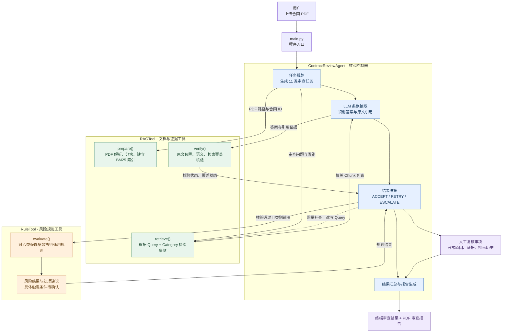
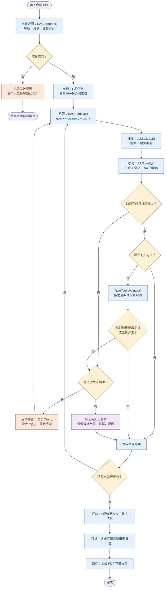

# 合同审查 Agent 系统设计说明
这是一个“以 Agent 为决策中心、以 RAG 为证据基础、以规则工具为风险检查手段，并具有反馈重试和人工复核出口”的合同审查系统。

## 1. System Overview｜系统概述

用户提供合同 PDF，Agent 自动检查关键信息和条款，寻找合同原文证据，核验答案可信度，按适用规则评估风险；遇到不确定结果会补查，必要时标记人工复核。

- **输入**：一份合同 PDF 文件。
- **核心处理**：解析合同 → 基本信息及条款审查 → 证据核验 → 规则检查及风险评估 → 审查报告/补查或人工复核。
- **目标输出**：输出审查报告。报告包含合同名称、条款识别结果、风险等级、合同原文片段、补查或处理建议、是否需要人工复核。

**为什么要用到 Agent？** 
合同审查不仅需要从长文本中提取信息，还需要验证证据、识别潜在风险，并处理检索失败或结论不确定的情况。LLM难以充分处理这些动态问题。因此，我们设计了一个具备工具调用、反馈重试和人工复核机制的Contract Review Agent。Agent 通过协调 RAGTool、LLM 和 RuleTool，在证据充分时接受结果，在证据不足时主动补查，在无法确认时转交人工复核，从而提高审查过程的可追溯性和可靠性。LLM 负责理解条款；Agent 负责决定何时调用检索、核验和规则工具，以及结果不可靠时是继续补查还是交给人工。

## 2. System Architecture｜系统架构与模块分工



**模块职责**

| 模块 | 负责什么 | 不负责什么 |
|---|---|---|
| `main.py` | 读取运行参数、初始化 Agent 和工具、启动审查 | 不直接分析合同条款 |
| `ContractReviewAgent` | 创建任务、调用 LLM 和两个业务工具、判断重试/人工复核、汇总结果 | 不自行解析 PDF 或实现风险规则 |
| `RAGTool` | PDF 解析、分块与 BM25 检索、证据位置与语义核验 | 不直接给出法律风险等级 |
| `RuleTool` | 根据已核验的条款信息判断是否触发规则并输出规则结果 | 不承担合同检索 |
| LLM | 阅读检索片段、提取答案及原文引用 | 不自行编造证据位置，不替代程序核验 |
| 报告输出层（目标） | 终端格式化打印、PDF 排版和导出 | 不重新判断条款风险 |

**边界**：Agent 对外只调用 `RAGTool` 和 `RuleTool` 两个业务工具；LLM 是 Agent 内部的模型调用能力。RAG 的语义核验也可使用其内部配置的模型。

## 3. Tasks & States｜审查任务与状态

### 3.1 条款识别任务类型

| ID | 条款类别 | 中文理解 | 是否为规则候选类别 |
|---|---|---|---|
| Q1 | Document Name | 合同名称 | 否 |
| Q2 | Parties | 合同签约方 | 否 |
| Q3 | Agreement Date | 合同签署日期 | 否 |
| Q4 | Effective Date | 合同生效日期 | 否 |
| Q5 | Expiration Date | 合同到期日期 | 否 |
| Q6 | Governing Law | 合同适用法律 | 是 |
| Q7 | Renewal Term | 续约期限 | 是 |
| Q8 | Notice Period To Terminate Renewal | 阻止自动续约所需提前通知期 | 是 |
| Q9 | Insurance | 保险义务 | 是 |
| Q10 | Audit Rights | 审计或检查权 | 是 |
| Q11 | Termination For Convenience | 无需违约理由的便利终止权 | 是 |

**注意**：“规则候选”不等于“必定触发风险规则”。Q6–Q11 才有机会调用 `RuleTool`，具体触发条件由 RuleTool 决定；Q1–Q5 不调用 RuleTool。

### 3.2 三组关键状态

| 状态维度 | 取值 | 解释 |
|---|---|---|
| 抽取处理状态 `processing_status` | `COMPLETED` / `INCOMPLETE` / `ERROR` | 答案有没有正常抽取出来 |
| 证据核验状态 `verification_status` | `PASSED` / `FAILED` / `UNCERTAIN` | 证据是否支持答案 |
| Agent 决策 `next_action` | `ACCEPT` / `RETRY` / `ESCALATE` | 接受结果、继续补查、转人工复核 |

此外，`coverage_status` 使用 `SUFFICIENT` / `INSUFFICIENT` / `NOT_APPLICABLE`，主要用于判断“合同中没有某条款”的 `No` 结论是否经过足够检索。

## 4. Agent Workflow｜完整工作流程与条件分支

### 4.1 主流程图



> 图中“还有未处理任务？”表示切换到**下一项任务**，而不是重复上一项。各任务各自维护重试次数和检索历史。规则结果若要求复核，现有 Agent 会先在重试预算内尝试补查，预算用尽后才标记人工复核。

### 4.2 分阶段解释

**阶段 A：准备合同（只做一次）**

1. `main.py` 接收 PDF 路径并创建 Agent。
2. Agent 为文件生成唯一 `document_id`。
3. `RAGTool.prepare()` 解析 PDF，冻结规范化合同文本、分块、建立 BM25 索引，并缓存全文及块位置。
4. **判断**：成功则创建任务清单；失败则停止自动审查并记录文件处理异常，不把失败解释成“没有风险”。

**阶段 B：执行单项审查（对任务清单逐一进行）**

5. Agent 取当前任务的 `question_id`、`category`、`question`、`top_k`。
6. `RAGTool.retrieve()` 返回若干相关合同片段（Chunk），每段带 `chunk_id`、文本、全文起止位置和相关性分数。
7. LLM 只根据这些片段提取 `category_answer` 和原文引用；Agent **用程序**将引用定位为 `predicted_answers`，不能让 LLM 随意填写全文偏移量。
8. `RAGTool.verify()` 核验原文位置与语义；若答案为 `No`，还需检验是否已充分搜索相关合同内容。
9. **判断**：抽取完成、证据核验通过、`No` 覆盖充分时，进入下一步；否则走反馈重试分支。

**阶段 C：规则检查与结果决策**

10. Q1–Q5：保存基础信息结果，不调用 RuleTool。
11. Q6–Q11：在抽取和核验满足条件时调用 `RuleTool.evaluate()`；是否有适用规则由 RuleTool 自行决定。
12. **判断**：如果结果可信、没有阻断性规则状态，`ACCEPT`；如果仍存在不确定、失败或需要复核的规则状态，进入 `RETRY` 或 `ESCALATE`。

**阶段 D：报告输出**

13. 每项任务都以“接受结果”或“标记人工复核”结束，随后处理下一项。
14. 11 项处理完毕，汇总条款结论、证据、规则结果、检索/核验历史和人工复核清单。
15. **目标交付**：终端打印审查报告，并导出 PDF 报告；JSON 可作为内部中间结果和日志存档。

### 4.3 典型条件分支

| 发生情况 | 系统动作 | 为什么 |
|---|---|---|
| PDF 无法解析 | 停止审查、提示人工处理文件 | 没有可核验的原文 |
| 检索片段不足 | 补充关键词、扩大 `top_k` 再检索 | 避免漏掉不同措辞的条款 |
| LLM 没提取出可信答案 | 重新检索、重新抽取 | 当前候选不足以形成结论 |
| 原文引用位置不匹配 | 不通过核验，进入补查 | 防止虚构或错位引用 |
| 引用存在但不能支持答案 | 不通过/不确定，进入补查 | 原文出现关键词不等于支持结论 |
| `No` 但检索覆盖不足 | 继续补查，不直接接受 `No` | 没找到不代表不存在 |
| Q1–Q5 核验通过 | 保存结果，进入下一任务 | 基础信息不走风险规则 |
| Q6–Q11 核验通过 | RuleTool 判断是否有适用规则 | 规则只对候选类别有机会执行 |
| 规则要求人工复核 | 在重试预算内补查，仍未解决则升级 | 风险判断可能需要人工介入 |
| 超过重试上限 | `ESCALATE`，加入人工复核清单 | 避免无限循环或假装成功 |

## 5. Module Interfaces & I/O｜模块接口与数据流

### 5.1 关键接口

| 接口 | 主要输入 | 主要输出 |
|---|---|---|
| `Agent.run(file_path)` | PDF 路径 | 含结果的报告字典；准备失败时返回失败报告 |
| `RAGTool.prepare(document_id, file_path)` | 合同 ID、文件路径 | `status=SUCCESS/FAILED`、原因及索引统计 |
| `RAGTool.retrieve(document_id, query, top_k, category=None)` | 合同 ID、问题、数量、可选类别 | `text`：多个带位置的 Chunk |
| `Agent.extract(task, chunks, document)` | 当前任务、候选片段、合同信息 | `category_answer`、`predicted_answers`、处理状态 |
| `RAGTool.verify(document_id, category, category_answer, predicted_answers, retrieval_history=...)` | 类别、答案、证据及检索历史 | 证据检查、核验状态、覆盖状态、原因 |
| `RuleTool.evaluate(...)` | 合同/任务 ID、类别、答案、证据及核验状态等 | `review_results` 列表 |
| `Agent.decide_next_action(result)` | 本轮抽取、核验、规则与重试信息 | `ACCEPT` / `RETRY` / `ESCALATE` |
| 报告展示与 PDF 导出（目标） | 汇总报告字典 | 终端可读报告及 PDF 文件 |


### 5.2 数据示例

**当前任务**

```json
{
  "document_id": "DOC_001",
  "question_id": "Q6",
  "category": "Governing Law",
  "question": "Which jurisdiction's laws govern this agreement?",
  "top_k": 5
}
```

**RAG 检索片段**

```json
{
  "document_id": "DOC_001",
  "text": [
    {
      "chunk_id": "C120",
      "text": "This Agreement shall be governed by the laws of California.",
      "start": 120,
      "end": 181,
      "score": 4.8
    }
  ],
  "status": "OK"
}
```

**抽取结果**

```json
{
  "category": "Governing Law",
  "category_answer": "California",
  "predicted_answers": [
    {"text": "laws of California", "answer_start": 159}
  ],
  "processing_status": "COMPLETED"
}
```


## 6. Evidence Verification｜证据核验机制

**为什么核验？** LLM 可能答错，也可能引用看起来相关、实际上不支持结论的文字。系统因此设置三道检查。

1. **位置核验（程序检查）**：每条引用的 `text` 必须与冻结合同全文中 `answer_start` 对应的字符完全一致。失败则不能当作有效证据。
2. **语义核验（模型检查）**：检查引用是否真正支持 `category_answer`，而不仅仅是包含相似词语。若语义模型未配置或调用失败，返回不确定，不伪装为通过。
3. **覆盖核验（针对 `No`）**：当答案表示某类条款不存在时，不能仅凭“当前检索结果为空”就判定为 `No`；需要满足覆盖充分性条件。

| `verification_status` | 含义 | Agent 处理 |
|---|---|---|
| `PASSED` | 证据支持答案，且所需覆盖检查通过 | 可继续规则检查/接受 |
| `FAILED` | 存在不匹配或不支持的证据 | 补查或转人工 |
| `UNCERTAIN` | 当前证据、覆盖或模型能力不足以确认 | 补查或转人工 |

**重要区别**：检索相关性分数高，不等于条款结论真实；没有检索到条款，也不等于条款不存在。

## 7. Feedback, Retry & Human Review｜反馈、重试与人工复核

### 7.1 Feedback：系统如何发现问题

Agent 读取抽取状态、核验状态、覆盖状态及规则检查结果。只要其中存在阻断性问题，就不直接把结果当作最终可信结论。

### 7.2 Retry：如何补查

- **触发**：抽取未完成、证据核验失败/不确定、`No` 覆盖不足，或规则结果提示需要复核/发生异常。
- **动作**：`rewrite_query()` 增加法律术语和同义表达，提升 `top_k`，重新执行“检索 → LLM 抽取 → 证据核验 → 适用规则检查”。
- **限制**：默认 `max_retries=2`，即**首次尝试 + 最多两次补查**；每项任务独立计数。
- **记录**：保存每轮 Query、Top-K、检索片段 ID、核验结果及最终决策，便于解释为什么补查。

### 7.3 Human-in-the-Loop：何时转人工

- **进入条件**：补查次数耗尽，仍无法获得可信结果；包括持续的证据问题、覆盖不足或阻断性规则结果。
- **交给人工的材料**：任务类别、候选答案、原文证据、失败原因、检索历史、相关规则结果。
- **系统当前能力**：标记 `needs_manual_review=true` 并汇总 `manual_review_items`；**尚不等于有人已完成审核**，也不代表存在人工审核网页或审批平台。

**风险等级与人工复核是两个不同维度**：高风险条款可能证据充分；低风险或未评估条款也可能因证据不足而需要人工复核。

## 8. Report｜报告

### 8.1 最终交付形式

1. **终端打印**：合同名称、条款识别结果、风险等级、人工复核标记，以及 PDF 保存位置；必要时显示简要原文证据和建议。
2. **PDF 审查报告**：面向阅读和提交的正式报告，包含逐项条款结果与原文引用。
3. **JSON 内部存档**：保留完整结构化结果、状态、检索历史和日志，便于生成 PDF、调试及评测。

### 8.2 PDF 报告结构

**封面 / 基本信息**：报告标题、合同名称、文件名、合同 ID、生成时间、整体审查状态。

**审查总览**：条款识别任务的完成情况、已触发风险规则的数量、需要人工复核的数量；没有规则结论的条款应标为“未评估/无适用规则”，而不是“低风险”。

**逐项审查详情**：每个类别固定展示以下字段。

| 字段 | 展示内容 |
|---|---|
| 合同名称 | 识别到的合同名称；未能确认时使用文件名并标注来源 |
| 审查类别 | 例如 `Q9 Insurance` |
| 条款识别结果 | `category_answer` 或“未能确认” |
| 风险等级 | 由实际规则结果映射；没有结果则“未评估” |
| 合同原文片段 | `predicted_answers` 中可核对的引用，可附页码/位置 |
| 补查或处理建议 | 依据失败原因或规则结果给出；无充分依据时不编造建议 |
| 是否需要人工复核 | 是/否，并给出具体原因 |

**人工复核清单**：集中列出需要人工确认的任务、疑点、证据及建议处理方向。


### 8.3 报告展示样例

> **合同名称**：Example Service Agreement  
> **类别**：Q6 — Governing Law（适用法律）  
> **识别结果**：California  
> **风险等级**：Low  
> **合同原文依据**：This Agreement shall be governed by the laws of California.  
> **补查或处理建议**：根据组织内部司法管辖区政策进一步判断是否符合要求。  
> **是否需要人工复核**：否。


