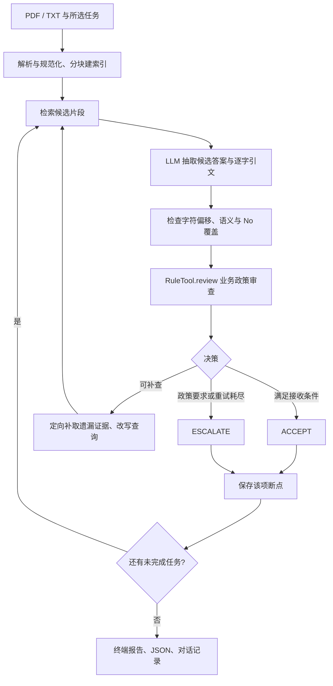

# CUAD 合同审查 Agent（41 类条款）

本目录是 `-RAG-Agent-` 项目的 Agent 集成实现，集成事实抽取、RAG 检索与证据核验、业务规则审查、补查和转人工。支持 PDF / TXT 合同，可审查全部 41 类或用户指定的条款。

程序将“是否识别到条款”“证据是否支持答案”“是否命中业务政策”和“是否需要人工复核”分别记录。自动接收表示本次自动流程通过，不等同于合同没有法律风险。内置政策用于项目演示，正式使用时应按审查主体和业务要求配置。

## 1. 能力与执行流程

- 41 项任务的编号与项目 `master_clauses` CSV 列顺序一致，使用 Q1–Q41；与旧 11 项版本的部分编号不同。
- 抽取和核验共用 `tools/clause_definitions.py` 中的类别定义及排除条件。
- 默认使用向量与 BM25 混合检索，结合类别查询扩展；底层支持 BM25 基线。
- 引文由程序在来源 chunk 内唯一定位，再验证规范化全文切片；不让模型生成字符偏移。
- 对候选 No 检查覆盖情况并进行全文语义核验；零关键词命中不会直接被视为条款不存在。
- 补查优先取回覆盖检查指出的遗漏片段，再进行查询扩展。
- 下游异常保留已完成阶段，重试核验或规则时复用前序结果；保存各轮历史。
- 逐项原子保存断点；运行过程即时保存为 JSONL，结束时保存 JSON 报告和对话记录。



解析失败时返回 FAILED，不创建可接收的条款结果。默认每项最多补查 2 次，即最多 3 轮业务尝试；协议格式修复和 SDK 网络重试可能产生额外 API 请求。

## 2. 目录结构

```text
code/
├── main.py                         # CLI、工具组装、终端输出与对话保存
├── README.md / RUNNING.md           # 完整说明 / 启动与恢复速查
├── requirements.txt                # 兼容范围依赖
├── requirements-lock.txt           # 本地验证的顶层依赖版本
├── .env.example                    # 抽取服务配置模板，无真实密钥
├── agents/
│   ├── clause_catalog.py           # 41 类任务编号、问句、名称和答案类型
│   ├── contract_review_agent.py    # 抽取、核验、规则、决策、重试与报告
│   ├── verification_adapter.py     # 核验 JSON 协议适配与一次格式修复
│   ├── checkpoint.py               # 配置指纹、断点校验与原子保存
│   └── terminal_report.py          # 面向用户的中文终端报告
├── tools/
│   ├── clause_definitions.py       # 抽取与核验共享的类别定义
│   ├── rag_tool/                   # 集成的检索、偏移检查与语义核验实现
│   │   ├── deepseek.local.env.example
│   │   └── rag_core/
│   └── rules/                     # 规则引擎、36 类规则注册表与默认政策
└── tests/                          # 不调用外部 API 的回归测试
```

实际运行后会生成 `outputs/` 和 `tools/.rag_cache/`。原始数据、真实 `.env`、模型缓存和历史结果不随代码上传。

## 3. 安装

推荐创建独立的 Python 3.12 环境。下列命令从仓库根目录执行：

```powershell
git clone https://github.com/Elena0701/-RAG-Agent-.git
cd .\-RAG-Agent-\4-agent\code
py -3.12 -m venv .venv
.\.venv\Scripts\Activate.ps1
python -m pip install --upgrade pip
python -m pip install -r requirements.txt
```

如果 PowerShell 阻止激活脚本，可以直接用 `.\.venv\Scripts\python.exe` 替代后续命令中的 `python`。

Linux / macOS：

```bash
python3.12 -m venv .venv
source .venv/bin/activate
python -m pip install -r requirements.txt
```

主入口还需要 `openai`、`python-dotenv`、`PyYAML`；不能只安装 RAG 子目录的依赖。`requirements-lock.txt` 记录本地验证时的顶层版本，可用 `python -m pip install -r requirements-lock.txt` 安装这些版本，但它不是包含所有间接依赖的完整锁文件。RAG 子目录的 lock 文件保留其独立实验版本，复现本集成版本应以根目录为准。

默认 Embedding 模型为 `sentence-transformers/multi-qa-MiniLM-L6-cos-v1`，revision 固定在 RAG 配置中。首次真实运行通常需要下载模型和分词器；下载目录由 Hugging Face / Sentence Transformers 配置决定，常见为用户目录下的 Hugging Face 缓存。离线测试不需要下载该模型。

## 4. 配置两个模型服务

### 4.1 事实抽取

```powershell
Copy-Item .env.example .env
```

编辑根目录 `.env`：

```dotenv
OPENAI_API_KEY=填写你自己的OpenAI_API_Key
OPENAI_BASE_URL=https://api.openai.com/v1
LLM_MODEL=gpt-4.1
```

抽取调用 `OpenAI.chat.completions.create`，当前参数包括 `temperature=0`。替换模型时须确认它支持该接口和参数；只支持 Responses API 的模型不能直接替换。使用其他兼容服务时，应同时修改 Key、Base URL 和模型名。

### 4.2 证据核验

```powershell
Copy-Item tools\rag_tool\deepseek.local.env.example tools\rag_tool\deepseek.local.env
```

编辑该文件：

```dotenv
DEEPSEEK_API_KEY=填写你自己的DeepSeek_API_Key
DEEPSEEK_BASE_URL=https://api.deepseek.com
DEEPSEEK_MODEL=deepseek-flash
DEEPSEEK_TIMEOUT_SECONDS=60
DEEPSEEK_MAX_TOKENS=4096
```

`deepseek-flash` 是当前集成的配置示例，请以你账户实际支持的模型名为准。核验客户端也实现了官方 OpenAI / AIHubMix 地址支持，具体地址校验位于 `rag_core/deepseek_client.py`。未配置可用核验模型时会返回 UNCERTAIN，不会跳过核验自动通过。

配置读取规则：

- 主入口通过 python-dotenv 读取根目录 `.env`，随后兼容读取 `agents/.env`；已有进程环境变量优先，不会被文件覆盖。
- 核验客户端读取 `tools/rag_tool/deepseek.local.env`，同名进程环境变量优先。仅在根 `.env` 写入 DeepSeek 字段，不会自动将这些字段注入核验客户端。
- 仓库不提供真实密钥。`.env`、`deepseek.local.env`、`.txt` 等本地密钥文件已加入忽略规则。

外发内容：抽取服务收到所选条款的候选片段，核验服务会收到规范化合同全文；补查会继续发送候选片段。请在已获得相应授权的数据上运行。

## 5. 命令行使用

所有命令从 `4-agent/code` 目录执行。文件名包含空格时用引号包围。

```powershell
# 查看条款编号
python main.py --list-clauses

# PDF / TXT 均支持；省略 --clauses 时审查全部 41 项
python main.py "D:\contracts\example.txt"
python main.py "D:\contracts\example.pdf"

# 指定条款
python main.py "D:\contracts\example.txt" --clauses Q3 Q5 Q17

# 原 11 类在当前 41 类目录下的编号
python main.py "D:\contracts\example.txt" --clauses Q1 Q2 Q3 Q4 Q5 Q6 Q7 Q8 Q16 Q34 Q39

# 自定义检索数量、补查次数、结果目录
python main.py "D:\contracts\example.txt" --top-k 5 --max-retries 2 --output-dir outputs

# 自定义业务政策；文件格式遵循 tools/rules/risk_rules.yaml
python main.py "D:\contracts\example.txt" --policy "my_policy.yaml"

# 显示技术日志
python main.py "D:\contracts\example.txt" --debug
```

| 参数 | 含义 | 默认 |
|---|---|---|
| `file_path` | PDF / TXT 合同路径 | 查看帮助和清单时可省略 |
| `--list-clauses` | 输出 41 类编号和名称后退出 | 关闭 |
| `--clauses` | 一个或多个 Q 编号，按目录顺序执行 | 全部 41 类 |
| `--model` | 覆盖事实抽取模型名 | `LLM_MODEL` |
| `--top-k` | 首轮相似检索候选数 | 5 |
| `--max-retries` | 每项最大补查次数 | 2 |
| `--output-dir` | 输出根目录 | `outputs` |
| `--policy` | 自定义政策文件 | 内置演示政策 |
| `--resume` | 指定逐项断点文件 | 新建独立运行 |
| `--debug` | 开启技术日志 | 关闭 |

定向补查片段优先加入候选集合，因此补查实际返回的片段数可以超过相似检索的 top-k。不要把 top-k 当成模型调用数量。

## 6. 中断恢复与文件输出

每项完成 ACCEPT 或 ESCALATE 后会原子更新：

```text
outputs/
├── checkpoints/{document_id}.checkpoint.json
├── conversations/{run_uuid}.jsonl
└── reports/
    ├── {document_id}.json
    └── {document_id}.conversation.json
```

终端会显示实际断点路径。中断后，在原命令末尾加 `--resume`：

```powershell
python main.py "D:\contracts\example.txt" --clauses Q3 Q5 Q17 --resume "outputs\checkpoints\实际文件名.checkpoint.json"
```

恢复须保持原合同、任务范围、抽取模型、核验配置、检索和重试参数、业务政策及代码一致。程序通过内容与配置指纹拒绝不兼容的旧结果，不按文件名猜测兼容性。已有终态任务（包括待人工复核项）跳过；中断中的那一项从头运行。恢复会重新解析合同并构建索引，不恢复内存中的模型客户端。要重新审查已经转人工的条款，应开始新运行并用 `--clauses` 选择它。

终端进度和中文报告输出至 **stderr**，机器可读的最终摘要输出至 **stdout**，因此可以分别保存：

```powershell
python main.py "D:\contracts\example.txt" 1> summary.json 2> terminal.log
```

进度会即时追加到 JSONL；最终 `.conversation.json` 包含本次命令所对应的用户配置、进度、终端报告和摘要，恢复运行有新的过程记录。最终摘要包含报告、对话、断点和 JSONL 的路径。

## 7. 答案、状态与转人工

### 7.1 答案约定

- Q1 / Q2：字符串或字符串列表。
- Q3–Q5：提示词要求 `MM/DD/YY`，例如 `10/24/05`；当前不增加严格日期格式校验。
- Q6 / Q7：期限字符串，保留工作日、适用条件等信息。
- Q8：准据法地区名称，特殊条件保留在证据中。
- Q9–Q41：`"Yes"`、`"No"` 或 `null`。Q38 在本项目 CSV / 规则口径中表示是否存在保修期限条款，而非抽取具体期限。
- `null` 表示未形成可确认答案，不能转换成 No。

### 7.2 状态字段

| 字段 | 值 | 含义 |
|---|---|---|
| `processing_status` | COMPLETED / INCOMPLETE / ERROR | 抽取完成 / 未完成 / 抽取或前序调用错误 |
| `verification_status` | PASSED / FAILED / UNCERTAIN | 证据支持 / 明确否决或偏移不符 / 无法确认 |
| `coverage_status` | SUFFICIENT / INSUFFICIENT / NOT_APPLICABLE | 否定答案覆盖情况 |
| `next_action` | ACCEPT / RETRY / ESCALATE | 接收 / 再尝试 / 转人工 |
| `needs_manual_review` | true / false | 最终是否待人工复核 |
| `stage_error` | null 或对象 | 异常发生阶段、类型和原因 |
| `attempt_history` | 对象列表 | 每轮候选答案、核验、规则及决策 |

覆盖不足不会覆盖明确的 FAILED；只会把原本 PASSED 的 No 降为 UNCERTAIN。No 的常规覆盖判定检查关键词锚点是否全部落在已返回片段中，但关键词覆盖不等于事实正确，还要做全文语义核验。零锚点且解析可靠、全文不超预算时允许进入全文核验，只有模型支持 No 才将覆盖标为 `FULL_CONTEXT_SEMANTIC_REVIEW`。

默认全文核验预算为 120,000 字符；超预算不会截断后假装完成，而会返回无法确认。长合同需要后续分段核验设计。

### 7.3 决策与规则模式

ACCEPT 要求抽取完成、核验通过、No 覆盖充分、无阶段异常及阻塞规则。

- 命中需人工确认的规则、需人工的上下文意见，或政策缺失：按决策条件转人工。
- 抽取不完整、证据不足或其他可重试情况：预算内补查，预算耗尽转人工。
- 对核验 / 规则抛出的异常，保留前序成功结果并只重试相应后续阶段。
- 原始候选、核验事实和业务风险分别记录，命中风险规则并不意味着抽取答案错误。

规则模块对 Q6–Q41 共 36 类提供统一接口，Q1–Q5 不执行业务规则。内置四种模式：

| 模式 | 行为 |
|---|---|
| INFORMATION_ONLY | 记录事实，不做风险触发 |
| FLAG_IF_CONDITION | 满足政策条件时提示风险 |
| REQUIRE_PRESENT | 按政策检查是否应存在指定条款 |
| CONTEXT_REVIEW | 记录需结合相关条款的复核意见 |

默认政策的部分适用性字段为 `null`，这是待业务确认的配置，会触发政策不完整提示；不要为了提高自动接收率随意改成 true / false。风险等级和阈值属于项目业务政策。

## 8. 输出文件、对话记录与终端展示

程序提供三类主要输出：**JSON 审查报告用于读取结构化结果，对话记录用于回看本次运行过程，终端输出用于直接查看进度和结论**。断点文件另外用于恢复任务，不替代最终报告。

下面路径以默认 `--output-dir outputs` 为例；指定其他目录时，所有文件随之保存到对应目录。

| 输出 | 保存位置 / 通道 | 生成时机 | 主要用途 |
|---|---|---|---|
| JSON 审查报告 | `outputs/reports/{document_id}.json` | Agent 返回报告后 | 保存完整条款结果、证据、规则和人工事项 |
| 最终对话记录 | `outputs/reports/{document_id}.conversation.json` | 中文报告生成后、正常收尾时 | 回看本次命令的用户配置、进度、报告和摘要 |
| 即时过程记录 | `outputs/conversations/{run_uuid}.jsonl` | 运行开始创建，消息逐条追加 | 中断时保留已写入的配置和进度 |
| 终端进度及中文报告 | `stderr` | 运行过程中及结束时 | 用户直接阅读，可重定向为日志 |
| 最终机器可读摘要 | `stdout` | 输出文件保存后 | 获取状态、数量及输出文件路径 |
| 逐项断点 | `outputs/checkpoints/{document_id}.checkpoint.json` | 运行初始化及每项完成后 | 通过 `--resume` 恢复，见第 6 节 |

### 8.1 JSON 审查报告

报告、最终对话记录及断点用相同的 `document_id` 关联。`document_id` 由合同文件名 stem 与随机后缀组成，同一合同独立重跑会生成不同标识；断点恢复沿用原标识。即时过程记录以每次命令的随机 UUID 命名，其实际路径由最终摘要的 `journal_path` 给出。

报告顶层字段：

| 字段 | 内容 |
|---|---|
| `document_id` | 本次合同审查标识 |
| `filename` | 输入合同文件名 |
| `status` | `COMPLETED`、`NEEDS_MANUAL_REVIEW` 或 `FAILED` |
| `checks` | 所选条款的最终结果，按 Q 编号顺序排列 |
| `manual_review_items` | 待人工复核条款、原因和证据包 |
| `execution_logs` | 带时间戳的执行事件与状态；不是完整终端文本 |
| `checkpoint_path` | 正常完成条款流程后的断点路径 |
| `prepare_result` | 预处理失败时提供的解析结果与失败原因 |

核心结构示例（仅示意字段，不代表真实运行结果）：

```json
{
  "document_id": "example_12345678",
  "filename": "example.txt",
  "status": "COMPLETED",
  "checks": [],
  "manual_review_items": [],
  "execution_logs": [],
  "checkpoint_path": "outputs/checkpoints/example_12345678.checkpoint.json"
}
```

正常运行时 `checks` 包含所选任务的结果。若预处理失败，`status` 为 FAILED、`checks` 为空，并提供 `prepare_result`；此时不保证存在所有正常成功路径的字段。

每项 `checks` 中主要记录：

| 字段 | 内容 |
|---|---|
| `question_id` / `category` | Q 编号及正式类别名 |
| `category_answer` | 抽取出的候选答案；需结合核验状态判断是否可采信 |
| `predicted_answers` | 逐字引文列表，每项包含 `answer_start` 和 `text` |
| `processing_status` | 抽取阶段状态 |
| `verification_status` | 整体证据核验状态 |
| `coverage_status` / `coverage_detail` | 候选 No 的覆盖状态、依据及遗漏位置等详情 |
| `evidence_checks` | 各引文的位置匹配和语义支持状态 |
| `overall_support` | 整体语义判断、`reason` 及支持引文的 `evidence_indices` |
| `review_results` / `rule_review` | 规则结果、风险等级、理由、上下文意见和配置问题 |
| `retry_count` / `retrieval_history` | 补查次数、历次问句及返回的 chunk ID |
| `stage_error` / `attempt_history` | 异常阶段及各轮尝试结果 |
| `next_action` / `needs_manual_review` | 最终处理动作与是否待人工复核 |

并非每条分支都有全部可选字段。例如未执行语义核验时可能没有 `overall_support`，应结合 `reason`、`diagnostic_codes` 或 `extraction_reason` 阅读。风险等级从具体命中的规则结果中读取，不要假设每项条款顶层都有 `risk_level`。

证据字段的含义：

- `answer_start` 是 **规范化合同文本中从 0 开始的字符偏移**，不是 PDF 字节位置，也不是原始 TXT 未规范化时的偏移。
- 程序检查 `context[start:start+len(text)] == text`。同一短语在指定 chunk 中重复且无法唯一定位时不会猜测位置。
- `evidence_indices` 指向本条款 `predicted_answers` 中的元素，既不是字符偏移，也不是条款编号。
- 候选 No 可以没有引文，但必须满足对应覆盖和全文核验条件，不能只看 `category_answer` 就认为已通过。

### 8.2 最终对话记录：`.conversation.json`

文件保存本次命令对应的用户配置与 Agent 展示消息，采用 `role` / `content` 结构，便于按聊天消息回放：

```json
{
  "document_id": "example_12345678",
  "messages": [
    {"role": "user", "content": "审查合同、所选条款、抽取模型及运行参数"},
    {"role": "assistant", "content": "运行进度消息"},
    {"role": "assistant", "content": "最终中文合同审查报告"},
    {"role": "assistant", "content": "最终JSON摘要文本"}
  ]
}
```

实际记录包含：

1. `user`：合同路径、所选条款、抽取模型、top-k、最大补查次数、输出目录和业务政策。
2. `assistant`：解析、检索、抽取、核验、规则、补查及转人工等进度消息。
3. `assistant`：完整中文终端审查报告。
4. `assistant`：包含结果数量和文件路径的最终摘要，作为字符串保存在 `content` 中。

这是 **运行配置与用户可见消息的记录**，不等于完整保存每次底层模型请求、提示词和响应。它在运行收尾时写入，若进程提前中断，可能尚不存在。

### 8.3 即时过程记录：`.jsonl`

JSONL 文件每行是一个独立的消息对象，运行时逐条追加，无需等待全部条款完成：

```jsonl
{"role":"user","content":"审查配置"}
{"role":"assistant","content":"📄 开始审查合同……"}
{"role":"assistant","content":"🔎 正在检索合同片段……"}
```

正常结束时也会写入中文报告和最终摘要。中断时，已写入的消息仍可查看；下一次恢复命令创建新的 JSONL，不会把多次命令自动合并成一份完整聊天历史。最终 `.conversation.json` 使用相同 document_id 的固定路径，恢复后收尾会重写该文件，内容对应恢复这次命令的展示过程。

JSONL 记录的是主入口追加的用户配置和 `progress()` 消息，**不是操作系统级的完整 stdout / stderr 录制**。参数错误、外部库直接打印的日志或未捕获异常的 traceback 不保证进入该文件；需要排查这些输出时应另外保存终端重定向日志。

### 8.4 终端输出

运行中会显示面向用户的节点提示，例如：

```text
📄 开始审查合同……
🔎 正在检索合同片段……
🧠 正在调用模型抽取答案……
✅ 核验通过……
📏 正在检查业务规则……
🔄 正在补查…… / 👤 转人工复核……
```

结束后先展示合同名称、类型、当事方及各所选条款的答案、处理结果、必要的风险和转人工原因，再展示有答案（包括候选答案）的证据溯源和审核意见，最后给出统计及保存路径。

没有答案的条款不会出现在证据详情中，但会出现在总体条款状态和人工列表中。合同类型是标题启发式归类；当事方角色仅在证据支持时展示。

展示片段（仅为格式示例，不是实验结果）：

```text
━━━━━━━━ 合同审查报告 ━━━━━━━━
📄 合同名称：Example Agreement ✅
📁 合同类型：协议（根据合同标题归类）
...
⚖️ 适用法律：California   ⚠️待人工复核   风险：中
   转人工原因：命中业务规则，需确认适用政策。
📋 总体状态：待人工复核
━━━━ 证据溯源及审核意见 ━━━━
...
━━━━ 审查结束 ━━━━
📊 共审查 N 项，自动接收 A 项，待人工复核 B 项。
💾 报告已保存：outputs\reports\example_12345678.json
```

进度和中文报告写入 stderr；stdout 最后输出的是 **运行摘要**，不是整个审查报告。摘要包含 `document_id`、`status`、`check_count`、`manual_review_count`、`report_path`、`conversation_path`、`checkpoint_path`、`journal_path`。

分别保存两个终端通道：

```powershell
python main.py "D:\contracts\example.txt" 1> summary.json 2> terminal.log
```

`summary.json` 用于程序获取结果位置，`terminal.log` 用于阅读进度、中文报告及终端错误；完整结构化审查结果仍应读取 `report_path` 指向的报告文件。只有正常执行到最终打印时 stdout 才包含该 JSON 摘要，中途失败不能假设重定向文件一定是有效 JSON。

### 8.5 中断后的文件可用性

| 情形 | 可以查看的内容 |
|---|---|
| 运行尚未结束或用户中断 | 已写入的 JSONL、已保存的逐项断点；不保证有最终报告和最终对话记录 |
| 正常完成，包含转人工项 | 最终 JSON 报告、最终对话记录、JSONL、断点及 stdout 摘要 |
| 预处理返回 FAILED 并完成收尾 | 失败 JSON 报告和对应展示记录；通过 `prepare_result` 查看失败原因 |
| 参数错误或程序提前异常退出 | 查看 stderr / 重定向日志；不保证所有输出文件均生成 |

## 9. 测试

从本目录执行，无需真实密钥，不发送合同、不下载 Embedding 模型：

```powershell
python -m unittest discover -s tests
```

回归覆盖：41 类任务分发与共享定义、No 覆盖及全文核验协议、引文位置、Q7 续约通知边界、规则模式与转人工、终端和对话输出、异常结果保留、定向补查、逐项断点及配置变化拒绝恢复。

发布前在已有开发环境运行测试；准确通过数量见本次提交说明。离线测试通过不等于真实合同识别准确率达标，也不等于已在全新环境完成所有模型下载和在线测试。

## 10. 41 类任务目录

| 编号 | 中文名称 | CUAD 类别 | 答案类型 |
|---|---|---|---|
| Q1 | 合同名称 | Document Name | ENTITY |
| Q2 | 合同当事方 | Parties | ENTITY |
| Q3 | 合同日期 | Agreement Date | ENTITY |
| Q4 | 生效日期 | Effective Date | ENTITY |
| Q5 | 到期日期 | Expiration Date | ENTITY |
| Q6 | 续约期限 | Renewal Term | DURATION |
| Q7 | 退出续约通知期限 | Notice Period To Terminate Renewal | DURATION |
| Q8 | 适用法律 | Governing Law | JURISDICTION |
| Q9 | 最惠待遇 | Most Favored Nation | BOOLEAN |
| Q10 | 竞争限制例外 | Competitive Restriction Exception | BOOLEAN |
| Q11 | 竞业限制 | Non-Compete | BOOLEAN |
| Q12 | 排他性安排 | Exclusivity | BOOLEAN |
| Q13 | 禁止招揽客户 | No-Solicit Of Customers | BOOLEAN |
| Q14 | 禁止招揽员工 | No-Solicit Of Employees | BOOLEAN |
| Q15 | 禁止贬损 | Non-Disparagement | BOOLEAN |
| Q16 | 无因终止 | Termination For Convenience | BOOLEAN |
| Q17 | 优先购买／要约／谈判权 | Rofr/Rofo/Rofn | BOOLEAN |
| Q18 | 控制权变更安排 | Change Of Control | BOOLEAN |
| Q19 | 转让限制 | Anti-Assignment | BOOLEAN |
| Q20 | 收入／利润分成 | Revenue/Profit Sharing | BOOLEAN |
| Q21 | 价格限制 | Price Restrictions | BOOLEAN |
| Q22 | 最低采购／交易承诺 | Minimum Commitment | BOOLEAN |
| Q23 | 使用量／数量限制 | Volume Restriction | BOOLEAN |
| Q24 | 知识产权归属转移 | Ip Ownership Assignment | BOOLEAN |
| Q25 | 知识产权共同所有 | Joint Ip Ownership | BOOLEAN |
| Q26 | 许可授予 | License Grant | BOOLEAN |
| Q27 | 许可不可转让 | Non-Transferable License | BOOLEAN |
| Q28 | 许可方关联企业相关许可 | Affiliate License-Licensor | BOOLEAN |
| Q29 | 被许可方关联企业相关许可 | Affiliate License-Licensee | BOOLEAN |
| Q30 | 无限使用许可 | Unlimited/All-You-Can-Eat-License | BOOLEAN |
| Q31 | 不可撤销／永久许可 | Irrevocable Or Perpetual License | BOOLEAN |
| Q32 | 源代码托管 | Source Code Escrow | BOOLEAN |
| Q33 | 终止后服务 | Post-Termination Services | BOOLEAN |
| Q34 | 审计权 | Audit Rights | BOOLEAN |
| Q35 | 无上限责任 | Uncapped Liability | BOOLEAN |
| Q36 | 责任限制 | Cap On Liability | BOOLEAN |
| Q37 | 约定损害赔偿／终止费用 | Liquidated Damages | BOOLEAN |
| Q38 | 保修期限相关条款 | Warranty Duration | BOOLEAN |
| Q39 | 保险义务 | Insurance | BOOLEAN |
| Q40 | 不起诉承诺 | Covenant Not To Sue | BOOLEAN |
| Q41 | 第三方受益人 | Third Party Beneficiary | BOOLEAN |

## 11. 常见问题与当前边界

- **401 / 无效密钥**：确认 Key 与 Base URL 属于同一平台，检查是否有进程环境变量覆盖 `.env`。
- **额度、限流或网络错误**：查看具体失败阶段和模型错误；修复配置后开始新运行或恢复未完成任务。改写检索问句不能解决账单问题。
- **核验一直 UNCERTAIN**：检查核验配置、全文长度、引文是否精确、覆盖是否充分以及类别定义。
- **PDF 无文本**：当前没有 OCR 流程；扫描件须先在本地 OCR 并检查文本可靠性，再输入。
- **大量转人工**：先区分政策命中、政策缺失、真实歧义和技术失败，不能仅把人工率当成模型错误率。
- **长合同与成本**：目前逐类执行，多次全文核验会增加 token、耗时和外发量；尚未实现分段全文核验、请求预算和稳定的并发调度。
- **服务化**：当前入口是终端，不包含 Web UI、多用户认证、持久化人工审批工作台或完整访问控制。
- **回归基线**：共享定义和模型切换后，需要在固定的真实样本上重新评估；本 README 不将历史运行数字当作当前版本准确率。

原始 CUAD 数据来源及使用条件请参阅 [The Atticus Project / CUAD](https://github.com/TheAtticusProject/cuad)。本目录不重新声明上游代码或数据许可证；分发前按仓库及各上游来源的许可要求管理。
