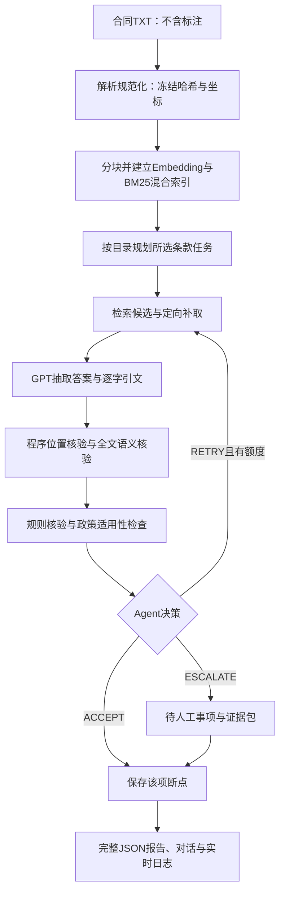

# 基于真实CUAD分销协议的41类合同初审与证据追溯

## 1 案例定位、材料边界与评价方法

本案例研究商业合同辅助初审中条款识别、证据可追溯性及有限补查的作用。正式主案例采用CUAD-004分销协议，补充采用CUAD-001战略联盟协议和CUAD-008内容许可修订协议。本轮运行了现有集成Agent，事实抽取和语义核验均调用配置的GPT服务，未使用桩替代真实案例输出。受控故障测试单独列于failure_cases.md，不混入本案例的自然运行统计。

本文采用CUAD-004进行完整案例运行分析：其包含多类目标安排、多处附件和责任例外，且已实际完成41项审查。

### 1.1 数据来源与选样

CUAD v1本地文件来自CUAD公开数据。实际检查完整JSON为510份、训练文件408份、测试文件102份，标题集合无交集且构成完整数据划分。三份样本均为train/development，没有使用清单中的evaluation_reserved样本。

| 样本 | 完整合同标题 | 原文字符 | 有答案类别 / 41 | 标注片段 | 选择理由 |
|---|---|---:|---:|---:|---|
| CUAD-001 | SIBANNAC,INC_12_04_2017-EX-2.1-Strategic Alliance Agreement | 8380 | 11 / 41 | 14 | 覆盖合同转让限制条款、无须违约事由的终止条款；同时保留其他类别的无答案情况 |
| CUAD-004 | EUROPEANMICROHOLDINGSINC_03_06_1998-EX-10.6-DISTRIBUTOR AGREEMENT | 56952 | 21 / 41 | 38 | 覆盖控制权变更条款、合同转让限制条款、无须违约事由的终止条款、赔偿责任限制条款、赔偿责任不设上限的条款 |
| CUAD-008 | GluMobileInc_20070319_S-1A_EX-10.09_436630_EX-10.09_Content License Agreement2 | 11954 | 9 / 41 | 25 | 五类目标均无答案标注，用于检查误报与弃答行为 |

CUAD-004在样本清单及原始JSON中的记录标题为“EUROPEANMICROHOLDINGSINC_03_06_1998-EX-10.6-DISTRIBUTOR AGREEMENT”。正文标题区同时出现“WATCHGUARD TECHNOLOGIES, INC.”与“DISTRIBUTOR AGREEMENT”，当事方为WatchGuard Technologies, Inc.与European Micro，不能把提交文件名中的企业名称直接替代合同标题。CUAD-008虽按标题归为内容许可合同，其context实际为AMENDMENT NO. 1，并非已取得全部被引用主协议。

### 1.2 数据隔离、哈希与字符坐标

提取脚本按样本清单完整标题唯一匹配，只将context.encode('utf-8')写入contracts/，不添加标题、BOM或换行。全部41项QA另存annotations/，保留id、question、answers.text、answer_start及is_impossible。77个标注片段的原文切片检查均通过；训练文件的问答拆分组织不作为gold来源。Agent仅读取TXT，标注在运行结束后才用于评价，没有把标准答案或后验评价送入提示词。

| 样本 | 原文SHA-256 | Agent规范化字符数 | 规范化SHA-256 |
|---|---|---:|---|
| CUAD-001 | `c0b6b7a59795c666d653f5bc73bddba2d852fc59c63b93b97d648a8c593c921f` | 8226 | `0a0f19ea154c3b83e13e4b3b79310f8ed9facbe7561b432d3cded4d60c9329a3` |
| CUAD-004 | `d806943ae391f6f5a4d5ee897e2b40107cc948056d0faff9d2e81d231fb059d8` | 51772 | `9cedf9be53f61d0b85efe6e85b2d156fc31629029f183bbccd1cbdce78e1154d` |
| CUAD-008 | `ab313de5385c0998e3242d39c567f21c4297e4f1c9eafbda33998f330deda36c` | 11913 | `94c2215df3c2af33a33b62fc1ebce207c20e3418289685026cfa2b97e2c4b49b` |

原文与规范化文本使用不同坐标。原文answer_start和Agent证据均以Unicode字符从0开始计数，但分别指向原始context与摄入后冻结文本，不能直接互换。摄入会统一换行、压缩空白、删除部分不可见字符、整理空行并补末尾LF。本项目已保存逐段映射和gold在规范化坐标下的投影；评价前同时核对文件哈希、规范化哈希及规范化器代码哈希。TXT报告中的page=1是合成映射。


### 1.3 四层评价与结论口径

分别评价：（1）候选答案是否符合目标类别；（2）引文是否真实、位置是否一致、是否支持含条件和例外的答案；（3）规则是否按所保存政策执行；（4）Agent是接受、补查还是人工升级。PASSED属于系统核验结果，ACCEPT属于流程决策，均不等同人工确认正确或合同无风险。

对于本轮五类布尔任务，候选Yes表示模型提出‘存在符合当前类别定义的安排’，候选No表示模型提出‘在本次输入文本范围内未识别到该类安排’的否定答案。候选尚需经过证据和覆盖核验，不能直接作为人工标准答案；No也不证明整个合同关系不存在该类安排。

| 类别 | 候选Yes的含义 | 候选No的含义 |
|---|---|---|
| Q16 无因终止 | 识别到无须违约等原因即可终止的安排 | 提出未识别到该类终止安排的否定候选 |
| Q18 控制权变更 | 识别到控制权变化引发终止、同意或通知要求的安排 | 提出未识别到该类触发安排的否定候选 |
| Q19 转让限制 | 识别到协议转让被禁止或须同意、通知等限制 | 提出未识别到该类转让限制的否定候选 |
| Q35 无上限责任 | 识别到明示无上限责任或取消适用上限的相关例外 | 提出未识别到该类责任安排的否定候选 |
| Q36 责任限制 | 识别到金额上限、计算公式或索赔期限等安排 | 提出未识别到该类责任限制的否定候选 |

Yes/No回答条款是否存在，不回答合同是否有风险或能否通过审查；例如Q36为Yes只表示识别到责任限制，仍需检查其主体、例外和政策含义。null表示无法确定，不能当作No。名称、日期、期限、适用法律等其他任务按各自类型输出，并非41类均使用Yes/No。ACCEPT只表示当前自动流程接收，不能据此把候选登记为人工确认正确；事实及证据正确而命中政策后ESCALATE，则属于正常人工复核流程。

评价类型包括正确识别、疑似误报/漏报、部分遗漏、证据错误、无法确认、正常政策提示与类别口径差异。空标注不证明条款不存在；额外片段不自动判误报；CUAD条款标注也不提供风险等级。本轮没有独立人工风险gold，没有真实人工复核签字，逐项结论均为自动辅助评价、待人工确认。

## 2 实验环境、版本及业务政策

现有Windows环境使用Python 3.12.1及4-agent/code/.venv。抽取配置模型为gpt-4.1，核验配置模型为gpt-4.1；抽取API实际返回model=gpt-4.1-2025-04-14，核验客户端没有保留服务端model字段，不虚构其服务端快照。

| 配置 | 实际值 |
|---|---|
| 本轮主实现 | 4-agent/code/，41类，Q6—Q41为36类规则接口 |
| Embedding | sentence-transformers/multi-qa-MiniLM-L6-cos-v1 |
| 固定revision | b207367332321f8e44f96e224ef15bc607f4dbf0 |
| 检索 | Embedding+BM25，retrieval_mode=embedding但实际retrieval_strategy=hybrid |
| 融合/排序 | structured_protected |
| 分块 | clause；chunk_size=800；overlap=120 |
| 首轮top-k / 最大补查 | 5 / 2 |
| 语义全文预算 | 120000 |
| 重排序 | False |
| 政策名称 | IPO商业合同初筛演示政策 |
| 审查立场配置 | {"scenario": "IPO商业合同初筛", "subject": "发行人", "users": ["受托律师", "券商尽调团队"]} |


续约上限12个月、退出续约通知阈值60天（AS_WRITTEN_DAYS），允许地区California/New York；这些均为项目演示政策。审计、保险、源代码托管在本合同的applicable为null，导致POLICY_INCOMPLETE。36类接口包含信息保留、条件触发、要求存在和上下文复核，不能称为36条确定性风险规则。政策原文件及其SHA-256与完整运行配置一并绑定在run_metadata的core_sources_before及policy字段中。


## 3 完整端到端执行过程



1. **合同输入与解析。** CUAD-004原文56952字符，规范化后51772字符；实际解析method=text、warnings=[]。该状态证明本次文本摄入成功，不证明附件或被引用文件齐全。

2. **索引与任务规划。** 105个分块建立混合索引，41项任务按clause_catalog固定顺序创建，共享一次索引。任务清单由代码确定，动态性主要体现在补查与动作选择，不夸大为模型任意规划法律任务。

3. **RAG检索与事实抽取。** 首轮top-k=5，模型仅阅读返回passages及类别定义，输出category_answer、evidence和uncertain。程序在指定chunk中唯一定位quote，再生成全局字符偏移，模型不负责生成偏移。抽取失败或未知保留状态，不能把null转写为No。

4. **证据与No核验。** 位置切片先行；错位直接失败且不调用语义模型。语义核验提供完整冻结context、候选、类别定义与引文。无引文No须先覆盖已有词法锚点；若存在未覆盖锚点，暂不执行全文核验。零锚点且解析无警告可走全文语义回退，SUPPORTED后才把覆盖置SUFFICIENT。锚点全覆盖与全文送审都是检查条件，均不构成确定性的不存在证明。

5. **规则核验。** 基础五类不调用业务风险规则；其他36类进入RuleTool接口。只有整体核验通过的支持性引文送入确定性比较，报告仍保留全部原始引用与检查。等级仅在规则确定触发时给出，信息模式或无结果列表不能解释为已判无风险。

6. **动作、补查与落盘。** Agent依抽取、核验、覆盖、政策及规则决定ACCEPT/RETRY/ESCALATE。补查按默认5→10→20扩大相似检索，定向块可能使实际返回数超过名义top-k，如Q16第二轮返回13块。POLICY_INCOMPLETE或已确认的政策触发可直接转人工；仍无法确认则最多补查两次。每项终态原子保存checkpoint，最终生成report、conversation与JSONL。

主运行的实际原生命令（由包装器组装，模型与政策从既有配置读取）：

```text
D:\xsl_use\yanyi\ai\大论文\FinAI\RAG-Agent\4-agent\code\.venv\Scripts\python.exe -B -u D:\xsl_use\yanyi\ai\大论文\FinAI\RAG-Agent\4-agent\code\main.py D:\xsl_use\yanyi\ai\大论文\FinAI\RAG-Agent\7-case-governance\contracts\CUAD-004.txt --output-dir D:\xsl_use\yanyi\ai\大论文\FinAI\RAG-Agent\7-case-governance\results\CUAD-004_20261125_145602_594025
```


### 3.1 三次成功运行与调用用量

| 样本 | 开始—结束（北京时间） | 秒 | 项数 | PASSED | ACCEPT / ESCALATE | 补查 | 抽取 / 核验调用 | prompt / completion / total tokens |
|---|---|---:|---:|---:|---|---:|---|---|
| CUAD-001 | 2026-11-25T14:50:20.103980+08:00—2026-11-25T14:51:39.862928+08:00 | 79.75 | 5 | 5 | 3 / 2 | 0 | 5 / 5 | 20962 / 848 / 21810 |
| CUAD-004 | 2026-11-25T14:56:02.754165+08:00—2026-11-25T15:02:39.043357+08:00 | 396.297 | 41 | 38 | 25 / 16 | 21 | 62 / 47 | 675606 / 12984 / 688590 |
| CUAD-008 | 2026-11-25T15:32:46.674511+08:00—2026-11-25T15:34:01.479289+08:00 | 74.812 | 5 | 5 | 5 / 0 | 1 | 6 / 5 | 29506 / 646 / 30152 |

三次成功运行的API错误计数均为0；自然运行中的语义失败与未知不属于网络请求失败。CUAD-004在披露约82次常规调用及补查上界后经用户确认执行一次。初次CUAD-001曾在沙箱内因WinError 10013中断于Embedding初始化，API跟踪为空；该尝试未混入以上成功运行用量。

## 4 CUAD-004全部41项结果

本表直接读取原始checks。‘—’表示该项没有确定风险等级，不代表零风险；‘上下文复核’可能只有context_review_notes而没有review_results。候选正确性及完整性另外见逐项辅助评价，不与系统PASSED混为一谈。

| QID / 类别 | 实际候选答案 | 核验 / 覆盖 | 规则结果或模式 | 确定触发等级 | 决策 | 补查 |
|---|---|---|---|---|---|---:|
| Q1 Document Name | WATCHGUARD TECHNOLOGIES, INC. DISTRIBUTOR AGREEMENT | PASSED / NOT_APPLICABLE | 基础信息，不适用规则 | — | ACCEPT | 0 |
| Q2 Parties | ["WatchGuard Technologies, Inc.", "European Micro"] | PASSED / NOT_APPLICABLE | 基础信息，不适用规则 | — | ACCEPT | 0 |
| Q3 Agreement Date | 11/05/97 | PASSED / NOT_APPLICABLE | 基础信息，不适用规则 | — | ACCEPT | 0 |
| Q4 Effective Date | 11/05/97 | PASSED / NOT_APPLICABLE | 基础信息，不适用规则 | — | ACCEPT | 0 |
| Q5 Expiration Date | None | UNCERTAIN / NOT_APPLICABLE | 基础信息，不适用规则 | — | ESCALATE | 2 |
| Q6 Renewal Term | 1 year | PASSED / NOT_APPLICABLE | RENEWAL-001:NOT_TRIGGERED | — | ACCEPT | 0 |
| Q7 Notice Period To Terminate Renewal | 30 days | PASSED / NOT_APPLICABLE | NOTICE-001:NOT_TRIGGERED | — | ACCEPT | 0 |
| Q8 Governing Law | State of Washington | PASSED / NOT_APPLICABLE | LAW-001:TRIGGERED | MEDIUM | ESCALATE | 1 |
| Q9 Most Favored Nation | No | PASSED / SUFFICIENT | CUAD-009:NOT_TRIGGERED | — | ACCEPT | 0 |
| Q10 Competitive Restriction Exception | No | FAILED / SUFFICIENT | CONTEXT_REVIEW | — | ESCALATE | 2 |
| Q11 Non-Compete | No | PASSED / SUFFICIENT | CUAD-010:NOT_TRIGGERED | — | ACCEPT | 0 |
| Q12 Exclusivity | No | PASSED / SUFFICIENT | CUAD-011:NOT_TRIGGERED | — | ACCEPT | 1 |
| Q13 No-Solicit Of Customers | No | PASSED / SUFFICIENT | CUAD-012:NOT_TRIGGERED | — | ACCEPT | 1 |
| Q14 No-Solicit Of Employees | No | PASSED / SUFFICIENT | CUAD-014:NOT_TRIGGERED | — | ACCEPT | 1 |
| Q15 Non-Disparagement | No | PASSED / SUFFICIENT | CUAD-015:NOT_TRIGGERED | — | ACCEPT | 0 |
| Q16 Termination For Convenience | Yes | PASSED / NOT_APPLICABLE | TERM-001:TRIGGERED | LOW | ESCALATE | 1 |
| Q17 Rofr/Rofo/Rofn | No | PASSED / SUFFICIENT | CUAD-017:NOT_TRIGGERED | — | ACCEPT | 0 |
| Q18 Change Of Control | Yes | PASSED / NOT_APPLICABLE | CUAD-018:TRIGGERED | MEDIUM | ESCALATE | 0 |
| Q19 Anti-Assignment | Yes | PASSED / NOT_APPLICABLE | CUAD-019:TRIGGERED | LOW | ESCALATE | 0 |
| Q20 Revenue/Profit Sharing | No | PASSED / SUFFICIENT | CUAD-020:NOT_TRIGGERED | — | ACCEPT | 1 |
| Q21 Price Restrictions | Yes | PASSED / NOT_APPLICABLE | CUAD-021:TRIGGERED | LOW | ESCALATE | 0 |
| Q22 Minimum Commitment | Yes | PASSED / NOT_APPLICABLE | CUAD-022:TRIGGERED | LOW | ESCALATE | 0 |
| Q23 Volume Restriction | No | PASSED / SUFFICIENT | CUAD-023:NOT_TRIGGERED | — | ACCEPT | 1 |
| Q24 Ip Ownership Assignment | No | PASSED / SUFFICIENT | CONTEXT_REVIEW | — | ACCEPT | 1 |
| Q25 Joint Ip Ownership | No | PASSED / SUFFICIENT | CONTEXT_REVIEW | — | ACCEPT | 1 |
| Q26 License Grant | Yes | PASSED / NOT_APPLICABLE | INFORMATION_ONLY | — | ACCEPT | 0 |
| Q27 Non-Transferable License | Yes | PASSED / NOT_APPLICABLE | CUAD-027:TRIGGERED | LOW | ESCALATE | 0 |
| Q28 Affiliate License-Licensor | No | PASSED / SUFFICIENT | INFORMATION_ONLY | — | ACCEPT | 0 |
| Q29 Affiliate License-Licensee | No | PASSED / SUFFICIENT | INFORMATION_ONLY | — | ACCEPT | 0 |
| Q30 Unlimited/All-You-Can-Eat-License | No | PASSED / SUFFICIENT | INFORMATION_ONLY | — | ACCEPT | 0 |
| Q31 Irrevocable Or Perpetual License | No | PASSED / SUFFICIENT | CUAD-031:NOT_TRIGGERED | — | ACCEPT | 1 |
| Q32 Source Code Escrow | No | PASSED / SUFFICIENT | CUAD-032:UNCERTAIN; POLICY_INCOMPLETE | — | ESCALATE | 0 |
| Q33 Post-Termination Services | No | PASSED / SUFFICIENT | CUAD-033:NOT_TRIGGERED | — | ACCEPT | 1 |
| Q34 Audit Rights | Yes | PASSED / NOT_APPLICABLE | AUDIT-001:UNCERTAIN; POLICY_INCOMPLETE | — | ESCALATE | 0 |
| Q35 Uncapped Liability | No | PASSED / SUFFICIENT | CUAD-035:NOT_TRIGGERED | — | ACCEPT | 2 |
| Q36 Cap On Liability | Yes | PASSED / NOT_APPLICABLE | CONTEXT_REVIEW | — | ESCALATE | 0 |
| Q37 Liquidated Damages | Yes | PASSED / NOT_APPLICABLE | CUAD-037:TRIGGERED | LOW | ESCALATE | 0 |
| Q38 Warranty Duration | No | UNCERTAIN / INSUFFICIENT | INFORMATION_ONLY | — | ESCALATE | 2 |
| Q39 Insurance | No | PASSED / SUFFICIENT | INS-001:UNCERTAIN; POLICY_INCOMPLETE | — | ESCALATE | 1 |
| Q40 Covenant Not To Sue | Yes | PASSED / NOT_APPLICABLE | CUAD-040:TRIGGERED | LOW | ESCALATE | 0 |
| Q41 Third Party Beneficiary | No | PASSED / SUFFICIENT | CONTEXT_REVIEW | — | ACCEPT | 1 |

主报告41项全部落盘，38项系统核验PASSED、2项UNCERTAIN（Q5/Q38）、1项FAILED（Q10）。25项ACCEPT、16项ESCALATE，补查合计21次。16项人工事项包括9项政策触发、3项政策适用性未知、1项上下文复核、3项自动流程未确认。该分组是报告原因归纳，不是人工复核结果。Q35虽属于25项ACCEPT，却被后验分析标记疑似漏报，说明不能把接收数当作正确数。

## 5 五个代表性条款的证据链

以下每项同时展示原始文本、规范化引文、实际检索、核验、规则和动作；引述的模型理由是被评价对象，不自动作为认定事实。详细各轮候选均可在原始attempt_history核对。

### 5.1 Q6 正常自动接收：有条件的一年续约

**实际候选及决策。** `1 year`；核验 `PASSED`；覆盖 `NOT_APPLICABLE`；最终 `ACCEPT`；补查0次。

| 轮次 | 候选 | 抽取状态 | 核验 / 覆盖 | 动作 |
|---:|---|---|---|---|
| 1 | 1 year | COMPLETED | PASSED / NOT_APPLICABLE | ACCEPT |

**检索记录。** 以下是原始报告保存的实际查询与返回块ID；请求中的候选原文可在同次api_trace对应extraction/request的passages中核查。

第1轮top-k=5，实际返回块：`C11202, C15017, C13507, C11695, C34688`。

```text
What is the renewal term after the initial term expires, including automatic or unilateral extensions?
```

**实际检索候选示例。** 以下直接取自最后一轮发送给抽取模型的passages，尚不代表有效引文；完整候选见该次请求。

候选块`C11202`：
```text
5.1 Term. The Term will commence on the Effective Date of this Agreement and will remain in effect, unless sooner terminated under paragraphs 5.2, 5.3, or 5.4, until the termination date specified in Exhibit A.

The Term will automatically renew for successive additional periods of one (1) year each, provided that: (a) Distributor has made all Guaranteed Minimum Purchases and has complied with the marketing requirements under paragraph 4.1(b); (b) the parties have agreed in writing upon the Guaranteed Minimum Purchase amounts and Product price discounts for the next subsequent one (1) year renewal period; 
```

候选块`C11695`：
```text
he Guaranteed Minimum Purchase amounts and Product price discounts for the next subsequent one (1) year renewal period; (c) neither party provided the other party with notice of such party's intention not to renew this Agreement at least thirty (30) days prior to any year's Expiration Date; and (d) neither party provided the other party with such notice as may be required pursuant to paragraphs 5.2, 5.3 or 5.4.
```

**原文与引文0。** CUAD原文坐标`[12137, 12538)`，规范化引文坐标`[11414, 11815)`。原文由已验证映射取回，空白替换边界可有整体映射，不把它称为PDF页码。

```text
The Term will automatically renew for successive additional periods of one (1) year each, provided that: (a) Distributor has made all Guaranteed Minimum Purchases and has complied with the marketing requirements under paragraph 4.1(b); (b) the parties have agreed in writing upon the Guaranteed Minimum Purchase amounts and Product price discounts for the next subsequent one (1) year renewal period; 
```

Agent实际引文：

```text
The Term will automatically renew for successive additional periods of one (1) year each, provided that: (a) Distributor has made all Guaranteed Minimum Purchases and has complied with the marketing requirements under paragraph 4.1(b); (b) the parties have agreed in writing upon the Guaranteed Minimum Purchase amounts and Product price discounts for the next subsequent one (1) year renewal period; 
```

程序位置与语义检查：
```json
{
  "answer_index": 0,
  "position_valid": true,
  "support_status": "SUPPORTED",
  "reason": "引文明确规定：“The Term will automatically renew for successive additional periods of one (1) year each…”（合同期限将在初始期限到期后自动续签1年）。后半句提供了自动续期的前提条件，比如完成最低采购量、双方书面同意下年度最低采购量和产品价格折扣等。因为该条款已直接表明续期期限为1年，且没有表述超出或减少此期间，因此该证据充分支持续期期限为“1年”的拟答。",
  "page": 1
}
```

**原文与引文1。** CUAD原文坐标`[12418, 12832)`，规范化引文坐标`[11695, 12109)`。原文由已验证映射取回，空白替换边界可有整体映射，不把它称为PDF页码。

```text
he Guaranteed Minimum Purchase amounts and Product price discounts for the next subsequent one (1) year renewal period; (c) neither party provided the other party with notice of such party's intention not to renew this Agreement at least thirty (30) days prior to any year's Expiration Date; and (d) neither party provided the other party with such notice as may be required pursuant to paragraphs 5.2, 5.3 or 5.4.
```

Agent实际引文：

```text
he Guaranteed Minimum Purchase amounts and Product price discounts for the next subsequent one (1) year renewal period; (c) neither party provided the other party with notice of such party's intention not to renew this Agreement at least thirty (30) days prior to any year's Expiration Date; and (d) neither party provided the other party with such notice as may be required pursuant to paragraphs 5.2, 5.3 or 5.4.
```

程序位置与语义检查：
```json
{
  "answer_index": 1,
  "position_valid": true,
  "support_status": "SUPPORTED",
  "reason": "该引文详细列举了自动续签生效的补充条件和例外（如提前30天不续约通知等），进一步补充了第0条证据，确保1年自动续签的执行需要满足具体条件但不影响续期周期本身。",
  "page": 1
}
```

**整体核验理由（模型原始输出）。**

```text
两条引文均直接阐述了初始期限届满后，合同将自动按照1年为一个续期单位续签。相关条件和例外已被完整列举，不存在无限续签或单方不受限的情况。证据内容符合“续期期限为1年”这一答案，完全支持问题所问。
```

**规则依据。** 模式`FLAG_IF_CONDITION`，规则执行状态`EXECUTED`。

```json
{
  "review_results": [
    {
      "rule_id": "RENEWAL-001",
      "status": "NOT_TRIGGERED",
      "risk_level": null,
      "reason": "单次续约期限 1 year 按 12 个月比较，不大于上限 12 个月。",
      "evidence_indices": [
        0,
        1
      ],
      "missing_fields": [],
      "requires_manual_review": false,
      "recommendation": "保留本类别事实及核验结果。"
    }
  ],
  "context_review_notes": [],
  "issues": []
}
```


**运行后辅助评价与人工建议。** 两条证据覆盖续约周期及四类条件，规则将1 year归一为12个月，未超过严格大于12个月的阈值，最终ACCEPT。人工复查时仍应检查最低采购、价格书面约定、不续约通知及终止分支；不把1 year简化为无条件自动续约。


### 5.2 Q19 政策命中：转让限制与两处证据

**实际候选及决策。** `Yes`；核验 `PASSED`；覆盖 `NOT_APPLICABLE`；最终 `ESCALATE`；补查0次。

| 轮次 | 候选 | 抽取状态 | 核验 / 覆盖 | 动作 |
|---:|---|---|---|---|
| 1 | Yes | COMPLETED | PASSED / NOT_APPLICABLE | ESCALATE |

**检索记录。** 以下是原始报告保存的实际查询与返回块ID；请求中的候选原文可在同次api_trace对应extraction/request的passages中核查。

第1轮top-k=5，实际返回块：`C44686, C12612, C27882, C14548, C26140`。

```text
Does assignment of this agreement require consent or notice?
```

**实际检索候选示例。** 以下直接取自最后一轮发送给抽取模型的passages，尚不代表有效引文；完整候选见该次请求。

候选块`C44686`：
```text
24. Assignment. Distributor will not assign all or any part of this Agreement or any of its rights under this Agreement without the prior written consent of WGT. Subject to the foregoing, this Agreement will be fully binding upon, inure to the benefit of and be enforceable by the parties and their respective successors and assigns.
```

候选块`C12612`：
```text
on by Distributor under this Agreement, unless such change is approved in advance and in writing by an officer of WGT;

(c) any assignment or attempted assignment of this Agreement by Distributor without the prior written consent of WGT;

(d) any solicitation by Distributor for the sale of the Product to resellers located outside the Territory;
```

**原文与引文0。** CUAD原文坐标`[49302, 49457)`，规范化引文坐标`[44702, 44847)`。原文由已验证映射取回，空白替换边界可有整体映射，不把它称为PDF页码。

```text
Distributor will not assign all or any part of this Agreement      or any of its rights under this Agreement without the prior written consent      of WGT.
```

Agent实际引文：

```text
Distributor will not assign all or any part of this Agreement or any of its rights under this Agreement without the prior written consent of WGT.
```

程序位置与语义检查：
```json
{
  "answer_index": 0,
  "position_valid": true,
  "support_status": "SUPPORTED",
  "reason": "本条款明确规定“Distributor will not assign all or any part of this Agreement or any of its rights under this Agreement without the prior written consent of WGT.”（未经WGT事先书面同意，分销商不得转让全部或部分本协议或其下的任何权利）。这明确表明协议的转让需获得WGT的书面同意，完全支持“需要同意”的结论。",
  "page": 1
}
```

**原文与引文1。** CUAD原文坐标`[13503, 13621)`，规范化引文坐标`[12736, 12849)`。原文由已验证映射取回，空白替换边界可有整体映射，不把它称为PDF页码。

```text
any assignment or attempted assignment of this Agreement by Distributor      without the prior written consent of WGT;
```

Agent实际引文：

```text
any assignment or attempted assignment of this Agreement by Distributor without the prior written consent of WGT;
```

程序位置与语义检查：
```json
{
  "answer_index": 1,
  "position_valid": true,
  "support_status": "SUPPORTED",
  "reason": "本条款规定：“any assignment or attempted assignment of this Agreement by Distributor without the prior written consent of WGT;”即未经WGT事先书面同意，任何转让或试图转让本协议的行为都是不可接受的。这支持了协议转让需要同意的结论。",
  "page": 1
}
```

**整体核验理由（模型原始输出）。**

```text
两个引用均直接表明协议的转让须经WGT事先书面同意，完全支持“需要同意”的答案。没有出现例外或矛盾描述。
```

**规则依据。** 模式`FLAG_IF_CONDITION`，规则执行状态`EXECUTED`。

```json
{
  "review_results": [
    {
      "rule_id": "CUAD-019",
      "status": "TRIGGERED",
      "risk_level": "LOW",
      "reason": "已发现相关条款，命中关注政策。",
      "evidence_indices": [
        0,
        1
      ],
      "missing_fields": [],
      "requires_manual_review": true,
      "recommendation": "确认转让条件、通知、同意及允许转让范围。"
    }
  ],
  "context_review_notes": [],
  "issues": []
}
```


**运行后辅助评价与人工建议。** 禁止转让和未经同意转让的情形均找到，核验通过后CUAD-019按存在性政策触发并转人工。CUAD另外标注终止权引导句，当前引文未独立保留该句，需连同5.2阅读；2比3不是三个独立条款的召回率。人工应核对同意主体、许可转让例外及终止后果。


### 5.3 Q16 补查后纠正：从No到有条件的Yes

**实际候选及决策。** `Yes`；核验 `PASSED`；覆盖 `NOT_APPLICABLE`；最终 `ESCALATE`；补查1次。

| 轮次 | 候选 | 抽取状态 | 核验 / 覆盖 | 动作 |
|---:|---|---|---|---|
| 1 | No | COMPLETED | UNCERTAIN / INSUFFICIENT | RETRY |
| 2 | Yes | COMPLETED | PASSED / NOT_APPLICABLE | ESCALATE |


**真实运行日志节选**

**检索记录。** 以下是原始报告保存的实际查询与返回块ID；请求中的候选原文可在同次api_trace对应extraction/request的passages中核查。

第1轮top-k=5，实际返回块：`C17838, C15461, C12111, C46027, C45320`。

```text
Can a party terminate this agreement without cause or breach?
```

第2轮top-k=10，实际返回块：`C10877, C11202, C13507, C13769, C17838, C15461, C14548, C12111, C11695, C46027, C49529, C45320, C15017`。

```text
Can a party terminate this agreement without cause or breach? Search related expressions: terminate without cause for convenience any reason no breach.
```

**实际检索候选示例。** 以下直接取自最后一轮发送给抽取模型的passages，尚不代表有效引文；完整候选见该次请求。

候选块`C15017`：
```text
er this Agreement where such failure continues for thirty (30) days after written notice thereof by Distributor to WGT; or

(c) for convenience whether or not extended beyond the Initial Term, provided Distributor gives WGT thirty (30) days' advance written notice and, within such thirty (30) day period, Distributor pays to WGT a lump-sum payment equal to fifty (50%) of the unpaid balance of cumulative Guaranteed Minimum Purchase amounts.
```

**原文与引文0。** CUAD原文坐标`[16098, 16437)`，规范化引文坐标`[15141, 15459)`。原文由已验证映射取回，空白替换边界可有整体映射，不把它称为PDF页码。

```text
(c)  for convenience whether or not extended beyond the Initial Term, provided      Distributor gives WGT thirty (30) days' advance written notice and, within      such thirty (30) day period, Distributor pays to WGT a lump-sum payment      equal to fifty (50%) of the unpaid balance of cumulative Guaranteed Minimum      Purchase amounts.
```

Agent实际引文：

```text
(c) for convenience whether or not extended beyond the Initial Term, provided Distributor gives WGT thirty (30) days' advance written notice and, within such thirty (30) day period, Distributor pays to WGT a lump-sum payment equal to fifty (50%) of the unpaid balance of cumulative Guaranteed Minimum Purchase amounts.
```

程序位置与语义检查：
```json
{
  "answer_index": 0,
  "position_valid": true,
  "support_status": "SUPPORTED",
  "reason": "该条款明确规定了Distributor可以“for convenience”(即无因由/非违约情形下)终止合同，无论是否延长期满。条件是：Distributor需提前30天书面通知WGT，并在该期间内一次性支付未付Guaranteed Minimum Purchase余额的50%给WGT。因此，Distributor确实拥有无因由终止合同的权利，且条款对终止方（Distributor）、通知期限（30天书面通知）、以及额外条件（支付一定费用）均有详细规定，完全符合题目中Termination for Convenience的核查标准。",
  "page": 1
}
```

**整体核验理由（模型原始输出）。**

```text
合同第5.4(c)条款清楚赋予了Distributor在满足提前30天书面通知及支付终止费等条件下，无须任何违约或特殊原因，可以自行决定终止本协议的权利。因此支持原答案“可以一方（Distributor，无因由）终止”。
```

**规则依据。** 模式`FLAG_IF_CONDITION`，规则执行状态`EXECUTED`。

```json
{
  "review_results": [
    {
      "rule_id": "TERM-001",
      "status": "TRIGGERED",
      "risk_level": "LOW",
      "reason": "已发现相关条款，命中关注政策。",
      "evidence_indices": [
        0
      ],
      "missing_fields": [],
      "requires_manual_review": true,
      "recommendation": "确认权利方、通知、费用及对发行人的影响。"
    }
  ],
  "context_review_notes": [],
  "issues": []
}
```


**运行后辅助评价与人工建议。** 首轮只引WGT因特定原因终止的条款而提出No；全文核验指出5.4(c)赋予Distributor无因终止，随后定向补查改为Yes。通知30天和支付未付累计最低采购额50%的条件已保留；TERM-001触发后转人工。最终仍未引用WGT在初始期限后提前90天的另一条终止安排，故存在性得到支持但全主体证据覆盖不完整。


### 5.4 Q38 补查耗尽：引文未定位与否定覆盖不足

**实际候选及决策。** `No`；核验 `UNCERTAIN`；覆盖 `INSUFFICIENT`；最终 `ESCALATE`；补查2次。

| 轮次 | 候选 | 抽取状态 | 核验 / 覆盖 | 动作 |
|---:|---|---|---|---|
| 1 | Yes | INCOMPLETE | UNCERTAIN / NOT_APPLICABLE | RETRY |
| 2 | Yes | INCOMPLETE | UNCERTAIN / NOT_APPLICABLE | RETRY |
| 3 | No | COMPLETED | UNCERTAIN / INSUFFICIENT | ESCALATE |

**检索记录。** 以下是原始报告保存的实际查询与返回块ID；请求中的候选原文可在同次api_trace对应extraction/request的passages中核查。

第1轮top-k=5，实际返回块：`C37046, C35234, C35913, C39350, C6007`。

```text
Does this agreement specify a warranty period against defects or errors in products, technology, or services?
```

第2轮top-k=10，实际返回块：`C37046, C35234, C35913, C39350, C6007, C18568, C1733, C40260, C41270, C37406`。

```text
Does this agreement specify a warranty period against defects or errors in products, technology, or services? Search related expressions: warranty period warrants defects errors months years from delivery acceptance.
```

第3轮top-k=20，实际返回块：`C37046, C35234, C35913, C39350, C18568, C6007, C1733, C333, C40260, C29143, C41270, C9154, C27882, C27056, C37406, C46027, C31041, C47574, C36369, C32111`。

```text
Does this agreement specify a warranty period against defects or errors in products, technology, or services? Search related expressions: warranty period warrants defects errors months years from delivery acceptance. Search all relevant sections and definitions; include alternative legal terminology.
```

**实际检索候选示例。** 以下直接取自最后一轮发送给抽取模型的passages，尚不代表有效引文；完整候选见该次请求。

候选块`C35234`：
```text
14. Warranty; Returns. WGT will permit Distributor and end-users purchasing through resellers to return any defective Product in accordance with the limited warranty contained in the applicable end-user license agreement or limited hardware warranty, as applicable, provided that the Distributor and end-user have compiled with the applicable warranty terms and conditions. In order to receive the remedy provided for hereunder, Distributor shall

 deliver to WGT a sample of the Product which Distributor finds to be defective in workmanship or materials, or damaged in shipment prior to Distributor assuming the risk of loss or damage , along with a written explanation of the alleged defect within thirty (30) days from the later of Distributor's initial receipt of such Product from WGT or from 
```

**引文。** 原始predicted_answers为空，未虚构引用位置；此项须结合覆盖诊断和全文核验评价。

运行后对照的CUAD原文片段`[39489, 39991)`（仅作评价，不是Agent已成功抽取的引文）：
```text
In order to receive the remedy provided for hereunder, Distributor shall


     deliver to WGT a sample of the Product which Distributor finds to be      defective in workmanship or materials, or damaged in shipment prior to      Distributor assuming the risk of loss or damage , along with a written      explanation of the alleged defect within thirty (30) days from the later of      Distributor's initial receipt of such Product from WGT or from the delivery      of such Product to an end-user.
```

第一轮模型原始响应（本项证据定位失败，不能把其中quote登记为有效证据）：
```json
{
  "category_answer": "Yes",
  "evidence": [
    {
      "chunk_id": "C35234",
      "quote": "WGT will permit Distributor and end-users purchasing through resellers to return any defective Product in accordance with the limited warranty contained in the applicable end-user license agreement or limited hardware warranty, as applicable, provided that the Distributor and end-user have compiled with the applicable warranty terms and conditions. In order to receive the remedy provided for hereunder, Distributor shall\n\ndeliver to WGT a sample of the Product which Distributor finds to be defective in workmanship or materials, or damaged in shipment prior to Distributor assuming the risk of loss or damage , along with a written explanation of the alleged defect within thirty (30) days from the later of Distributor's initial receipt of such Product from WGT or from"
    },
    {
      "chunk_id": "C35913",
      "quote": "alleged defect within thirty (30) days from the later of Distributor's initial receipt of such Product from WGT or from the delivery of such Product to an end-user. In the event WGT verifies a defect reported by Distributor and such defect affects more than one (1) Product, then at WGT's option, Distributor shall either certify destruction of all defective Products or return all Products which it alleges are defective to WGT."
    }
  ],
  "uncertain": false
}
```

**整体核验理由（模型原始输出）。**

```text
检索覆盖不足，未执行无引文 No 的全文核验。
```

**规则依据。** 模式`INFORMATION_ONLY`，规则执行状态`INFORMATION_ONLY`。

```json
{
  "review_results": [],
  "context_review_notes": [],
  "issues": [
    {
      "code": "EVIDENCE_NOT_VERIFIED",
      "message": "整体证据核验未通过。",
      "fields": [
        "verification_status"
      ]
    },
    {
      "code": "COVERAGE_INSUFFICIENT",
      "message": "No需要充分的覆盖检查。",
      "fields": [
        "coverage_status"
      ]
    }
  ]
}
```


**运行后辅助评价与人工建议。** 前两轮模型返回Yes，但quote在C35234中无法唯一定位，processing_status=INCOMPLETE，不能把候选Yes计为成功识别；实际请求块保留了换行后的空格，模型quote未逐字保留。第三轮改为No，未满足覆盖前置，因此未执行无引文No全文核验，最终转人工。应检查14条完整返修/通知条件与30天起算事件，不强行接受末轮No。


### 5.5 Q36 复杂责任安排：金额上限引文遗漏关键例外

**实际候选及决策。** `Yes`；核验 `PASSED`；覆盖 `NOT_APPLICABLE`；最终 `ESCALATE`；补查0次。

| 轮次 | 候选 | 抽取状态 | 核验 / 覆盖 | 动作 |
|---:|---|---|---|---|
| 1 | Yes | COMPLETED | PASSED / NOT_APPLICABLE | ESCALATE |

**检索记录。** 以下是原始报告保存的实际查询与返回块ID；请求中的候选原文可在同次api_trace对应extraction/request的passages中核查。

第1轮top-k=5，实际返回块：`C41537, C32825, C37046, C27882, C41962`。

```text
Does this agreement limit liability through a monetary cap, recovery limit, or time restriction?
```

**实际检索候选示例。** 以下直接取自最后一轮发送给抽取模型的passages，尚不代表有效引文；完整候选见该次请求。

候选块`C41537`：
```text
18. Limitations of Liability. EXCEPT AS PROVIDED IN PARAGRAPH 15, WGT'S LIABILITY(WHETHER IN CONTRACT, WARRANTY, TORT (INCLUDING NEGLIGENCE WHETHER ACTIVE, PASSIVE, IMPUTED), PRODUCT LIABILITY, STRICT LIABILITY OR OTHER THEORY) UNDER THIS AGREEMENT OR WITH REGARD TO ANY PRODUCT OR OTHER ITEMS FURNISHED UNDER THIS AGREEMENT WILL IN NO EVENT EXCEED THE COMPENSATION PAID TO WGT CONCERNING SUCH PRODUCT UNDER THIS AGREEMENT.
```

**原文与引文0。** CUAD原文坐标`[45969, 46351)`，规范化引文坐标`[41603, 41960)`。原文由已验证映射取回，空白替换边界可有整体映射，不把它称为PDF页码。

```text
WGT'S      LIABILITY(WHETHER IN CONTRACT, WARRANTY, TORT (INCLUDING NEGLIGENCE WHETHER      ACTIVE, PASSIVE, IMPUTED), PRODUCT LIABILITY, STRICT LIABILITY OR OTHER      THEORY) UNDER THIS AGREEMENT OR WITH REGARD TO ANY PRODUCT OR OTHER ITEMS      FURNISHED UNDER THIS AGREEMENT WILL IN NO EVENT EXCEED THE COMPENSATION      PAID TO WGT CONCERNING SUCH PRODUCT UNDER THIS AGREEMENT.
```

Agent实际引文：

```text
WGT'S LIABILITY(WHETHER IN CONTRACT, WARRANTY, TORT (INCLUDING NEGLIGENCE WHETHER ACTIVE, PASSIVE, IMPUTED), PRODUCT LIABILITY, STRICT LIABILITY OR OTHER THEORY) UNDER THIS AGREEMENT OR WITH REGARD TO ANY PRODUCT OR OTHER ITEMS FURNISHED UNDER THIS AGREEMENT WILL IN NO EVENT EXCEED THE COMPENSATION PAID TO WGT CONCERNING SUCH PRODUCT UNDER THIS AGREEMENT.
```

程序位置与语义检查：
```json
{
  "answer_index": 0,
  "position_valid": true,
  "support_status": "SUPPORTED",
  "reason": "该条款明确规定，WGT在本协议项下的责任（无论是基于合同、保证、侵权、产品责任等理论），在任何情况下，均不会超过就该产品根据本协议向WGT支付的赔偿金额。这明确设立了以实际支付给WGT的金额为上限的金钱赔偿额限制（monetary cap），属于责任上限条款，支持协议确实设置了责任的金钱上限。",
  "page": 1
}
```

**整体核验理由（模型原始输出）。**

```text
引用条款直接规定了WGT承担的最大责任金额等于就相关产品支付给WGT的赔偿金，明确支持“有责任上限（monetary cap/recovery limit）”这一答案。
```

**规则依据。** 模式`CONTEXT_REVIEW`，规则执行状态`CONTEXT_REVIEW`。

```json
{
  "review_results": [],
  "context_review_notes": [
    {
      "rule_id": "CUAD-036",
      "related_categories": [
        "Uncapped Liability"
      ],
      "note": "结合金额上限、索赔时间限制、无上限责任及适用例外。",
      "evidence_indices": [
        0
      ],
      "requires_manual_review": true
    }
  ],
  "issues": []
}
```


**运行后辅助评价与人工建议。** 原文第18条以EXCEPT AS PROVIDED IN PARAGRAPH 15开头，但最终引文从WGT'S LIABILITY开始，截去了第15条例外。PASSED只说明本次模型给出支持，不证明满足当前类别定义所要求的保留exclusions；此处存在证据完整性缺陷。上下文政策将Q36转人工形成部分防护；原文第15条侵权赔偿、18条上限、19条损失排除及Q35必须联合复核。

## 6 补充观察：CUAD-008的否定答案检查

本节仅补充说明否定答案的检查机制，正式端到端主案例仍为CUAD-004。CUAD-008仅审查Q16/Q18/Q19/Q35/Q36，五类gold均为空；实际候选均为无引文No，最终全部PASSED/SUFFICIENT/ACCEPT。

其中，Q19首轮仅覆盖11处词法锚点中的6处，系统先返回UNCERTAIN；定向补查后覆盖全部11处，再经全文语义核验接收No。Q16、Q18零锚点时也执行了全文语义核验，并未仅凭零命中放行。该补充观察说明覆盖前置和有限补查实际生效，不证明否定结论在完整合同文件组合内必然正确。

本轮五类没有产生肯定候选，未观察到相应阳性误报，但不能据此计算阳性精确率或宣称总体误报率为零。详细覆盖统计、修订文本的类别边界及主协议缺失问题统一放在[局限与治理文档](limitations_and_governance.md)第2.1节；Q19解释措辞作为待确认的边界观察见[失败分析文档](failure_cases.md)N08，不作为五项No均错误的证据。


## 7 人工复核与案例结论

原始人工队列是Q5/Q8/Q10/Q16/Q18/Q19/Q21/Q22/Q27/Q32/Q34/Q36/Q37/Q38/Q39/Q40。系统状态为PENDING_HUMAN_REVIEW，不代表有人已审阅。本轮辅助分析还建议复核原本ACCEPT的Q35，并检查CUAD-008主协议完整性与Q19范围；这些建议独立存储，不改写原始16项清单。完整触发条件、证据包、处理方式和空白记录模板见limitations_and_governance.md。

本案例支持以下有限结论：系统能够在当前文本、模型与演示政策下跑通合同内混合检索、结构化抽取、位置与语义核验、规则及动作落盘；覆盖前置和补查在Q16、CUAD-008 Q19中确有可追溯的作用；政策触发、政策缺失与模型无法确认可以在报告中区分。与此同时，Q35、Q36显示同一模型抽取与核验仍可共同遗漏例外，规则无法弥补上游事实错误，人工复核不能只覆盖原始ESCALATE清单。

不能从三份训练侧开发样本推导整体模型准确率、中文合同效果、法律适用性或优于其他架构的因果结论；不能把25项自动接收说成25项正确，也不能把16项人工事项说成16个法律风险。


原始运行命令记录在各run_metadata；操作步骤见README.md。原始合同、标注、API跟踪含完整文本，保持本地保存，不因论文整合而擅自上传。
